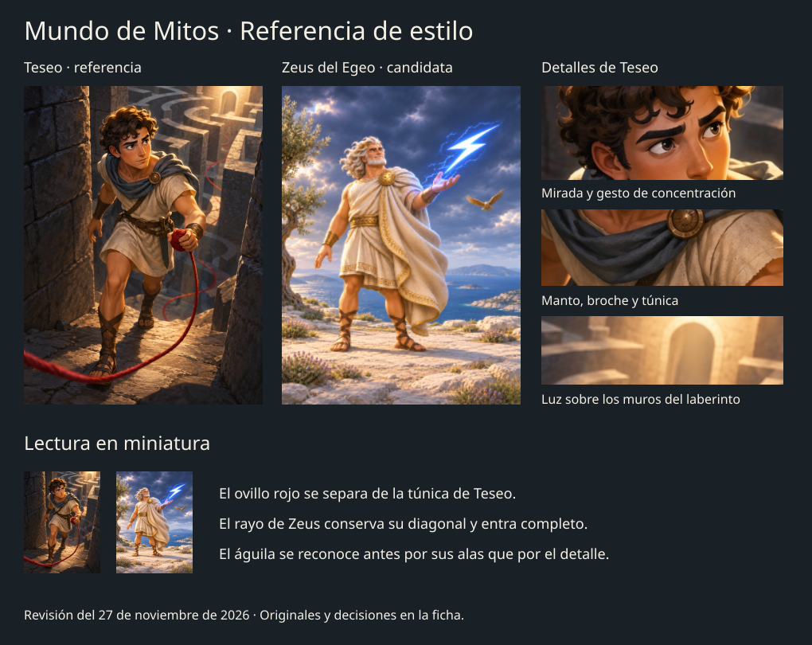

# Teseo y Zeus del Egeo

[Elenco y fichas de los 85 personajes](elenco.md) · [Guía de estilo](../estilo_visual_aprobado.md) · [Seguimiento](../seguimiento_personajes.md)

## Teseo · referencia común

La dirección de la mirada y las cejas expresan concentración. Los pliegues anchos del manto, el brillo corto del broche y la superficie mate de la túnica se distinguen aun con colores cercanos. La luz lateral dibuja el pelo y deja parte del laberinto en sombra. En otro personaje se conserva ese tratamiento, con su propia edad, expresión y contextura. El hilo rojo guía la mirada desde el primer plano hasta el fondo y cuenta qué hace Teseo. Cada ficha necesita su propio recurso narrativo.

[Original de Teseo fijado a la revisión](https://github.com/willyesposito/JuegoMitosFeli/blob/020e843b2991bc277aa0eacfe90f54c66689c516/imagenes/teseo.jpg) · Blob `da0963ae1a550b8ef0f3b9878f5ec2008f63cb57`.

## Zeus · revisión del 27/11/2026

La lámina usa la candidata **Zeus, relámpago y águila del Egeo**, identificada por el paisaje y el rayo. En Drive también existe un archivo de la tanda del 7/11 cargado más tarde. La fecha de carga por sí sola no identifica una revisión de diseño. La candidata sigue pendiente de la decisión de Willy.

| Aspecto | Qué se ve | Decisión propuesta |
|---|---|---|
| Escena | Olivo, costa rocosa e islas. La rama enmarca la figura y la luz cálida la despega de la tormenta. | Conservar la lectura griega. Si se busca que se reconozca el Olimpo en particular, el paisaje costero solo no alcanza. |
| Rayo | Grande, entero, con aire en la punta y luz azul en palma y antebrazo. El centro blanco tiene una silueta muy geométrica. | Conservar escala y posición. Si se hace otra versión, probar un núcleo de descarga más irregular. |
| Águila | Silueta dorada aislada contra el cielo a la derecha. En miniatura se distingue el ave, con poca información de especie. | Acercarla un poco si Feli no la identifica. |
| Rostro y cuerpo | La cabeza alta y la mano abierta transmiten mando. La sonrisa, el mentón ancho y el brazo descubierto son más exagerados que en Teseo. | Probar expresión serena y brazo menos marcado en una eventual corrección. |
| Vestimenta | Manto marfil lateral, greca dorada y broche visible. El conjunto ceremonial domina buena parte de la figura. | Conservar el peso de la tela. Willy decide si la lectura de rey está lograda. |

[Candidata original en Drive](https://drive.google.com/file/d/1vuhHwayl8dp99bbEaZgg-daeyuMpTWUw/view?usp=drivesdk) · [Zeus integrado en esta revisión](https://github.com/willyesposito/JuegoMitosFeli/blob/020e843b2991bc277aa0eacfe90f54c66689c516/imagenes/zeus.jpg) · [Orden de Zeus](../../Produccion/zeus.md).

## Encuadre y revisión futura

El frente de carta usa proporción 3:4, altura `min(470px, 56vh)`, ancho limitado por su contenedor y recorte centrado con `object-fit: cover`. La lámina muestra el arte completo y una reducción a 96 × 128 como prueba adicional. Abrir también la carta en el juego en celular, tablet y PC. Registrar dispositivo, tamaño visible y qué se pierde. Prueba en equipos físicos y reconocimiento por Feli pendientes. [Estilos de la colección](../../estilos.css).

Para una nueva escena, registrar la imagen de origen, el atributo que permite reconocer al personaje, lo que se conserva, el cambio propuesto y el resultado en miniatura. Si Willy aprueba, guardar la fecha, sus palabras y el enlace a esa versión. Las candidatas originales se guardan en Drive hasta que se decida su integración.

[Comparador con el CSS del juego](comparar.html). Abrir desde una copia del repositorio o su servidor web. Ajusta el frente a la ventana y usa una copia reducida de la candidata para evaluar el encuadre.
