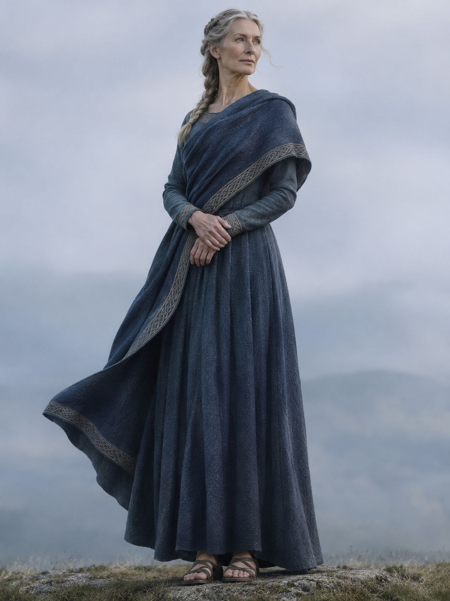
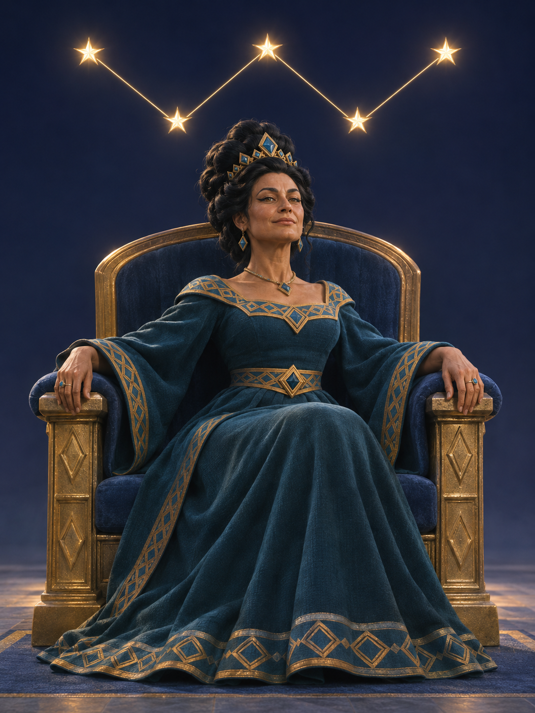
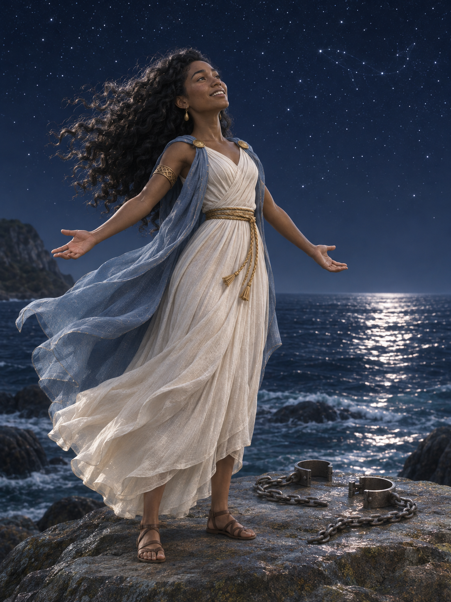
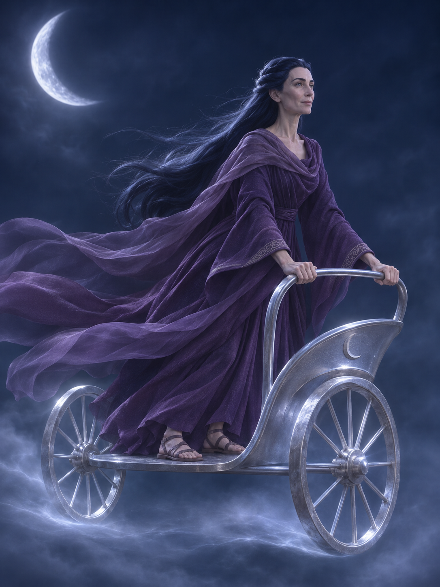
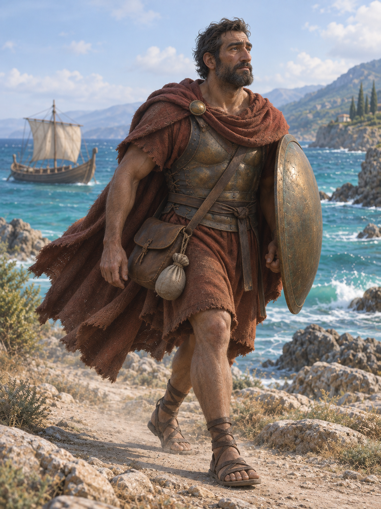

# Revisión de coherencia visual — 2026-11-05

**Estado: cuatro propuestas nuevas pendientes de aprobación de Willy.** Frigg se conserva como referencia de acabado. No se reemplaza ninguna imagen del juego.

## Identificación comprobada y estado previo

Los cinco son **Frigg, Casiopea, Andrómeda, Selene y Eneas**. Fuente: `Documentacion/criterio_riqueza_narrativa_2026-11-04.md` (tabla de los cinco) y commit `c7ac44befa865c43697fa1a80045a942ffab7651`. Rama consultada: `claude/game-setup-v98pr1`, cabeza previa `360a043c33dc92e1e1aa67276feacd26c6850ae1`.

| Personaje | Última imagen encontrada antes de esta revisión | Verificación |
|---|---|---|
| Frigg | `Produccion/reconstrucciones_2026-11-04/frigg/propuesta.png` | Propuesta de tejido grueso ya guardada, pendiente de aprobación; apariencia humana adecuada a referencia pedida. |
| Casiopea | `Produccion/reconstrucciones_2026-11-04/casiopea/propuesta.png` | Cinco estrellas presentes pero líneas curvas y trono con vértices extra; acabado caricaturesco. No se localizó una versión posterior de acabado humano que menciona Willy. No inventar que está guardada. |
| Andrómeda | `Produccion/reconstrucciones_2026-11-04/andromeda/propuesta.png` | Propuesta de liberación guardada, pendiente de aprobación; rostro de animación aún sin corregir. |
| Selene | `imagenes/selene.png` | Imagen vigente de animación; ficha de rediseño actualizada, sin propuesta del 4/11 guardada en la carpeta de reconstrucciones. |
| Eneas | `imagenes/eneas.png` | Imagen vigente con cara estilizada; ficha de viaje actualizada, sin propuesta del 4/11 guardada en la carpeta de reconstrucciones. |

Se abrieron visualmente las cinco imágenes, además de consultar fichas, historial y notas. Las imágenes se descargaron desde URLs fijadas al commit anterior para evitar ambigüedad de versiones. El conector textual no entrega binarios grandes; se recuperaron los PNG por sus URLs raw. La edición recibió las imágenes del personaje y Frigg como referencias recientes de conversación porque el generador rechazó rutas absolutas de Windows. No se generaron personajes desde cero ni sólo con su nombre.

## Decisión de estilo y causa corregida

Willy pide apariencia humana creíble integrada en fantasía para todos, al grado de Frigg en rostro, anatomía, materiales e iluminación. El estilo anterior imponía animación 3D, ojos grandes, superficies pulidas y rechazo de fotografía, exceptuando a Frigg; ese texto alimentaba la inconsistencia. Se reemplazó el documento de estilo y se agregó una precedencia explícita en CLAUDE, MEMORY, guía, protocolo y prompt de generación. El estilo anterior se archiva como historial, sin borrar su trazabilidad.

La referencia común no implica caras, edades, pieles, ropa o fondos iguales. Magia e identidad individual se conservan; no se agregan dones para justificar efectos.

Casiopea exige cinco estrellas principales en W inequívoca, sin otros brillos que confundan. Para conservar lectura, se prioriza constelación separada y se simplifica el respaldo. Esta decisión actualiza la anterior obligación de duplicar la W en el trono.

## Galería de revisión

| Frigg — referencia conservada | Casiopea — propuesta | Andrómeda — propuesta |
|---|---|---|
|  |  |  |

| Selene — propuesta | Eneas — propuesta |
|---|---|
|  |  |

Cada carpeta conserva `antes.png` y `revision.md`. En Frigg, `referencia.png` es exactamente el mismo blob de la propuesta previa. Las otras cuatro contienen nuevas `propuesta.png`. Referencias exactas y hashes: `manifest.json`.

## Resultado observado y límites

- Casiopea: cinco centros, cuatro segmentos rectos, W legible y zona oscura limpia; rostro y materiales humanos. Revisar tono de piel y edad frente a la referencia preferida de Willy.
- Andrómeda: rostro humano, rizos e identidad costera conservados; cadenas abiertas separadas. Evocación celeste no acreditada como Cetus astronómicamente exacto.
- Selene: rostro humano y vestido actualizado; dos ruedas completas. **La perspectiva del eje y el borde de la estola siguen observados**, sin afirmar corrección constructiva integral.
- Eneas: rostro humano y equipo de viaje visible; protección, bolsa y provisiones como diseño artístico autorizado.
- Frigg: no se regenera ni se confunde elección de acabado con aprobación integral.

La inspección es visual; no acredita que cada condición de una orden esté cumplida. El objetivo de este lote es coherencia de acabado y W de Casiopea. La aprobación estética y cualquier integración dependen de Willy. No cambiar `personajes.json`, `imagenes/` ni archivos del juego para publicar estas propuestas automáticamente.

No se localizaron propuestas adicionales de Selene/Eneas del 4/11 ni la Casiopea humana mencionada. Si Willy las conserva fuera del repo, pedir esas referencias para cotejarlas; no negar que puedan existir fuera de esta rama.
